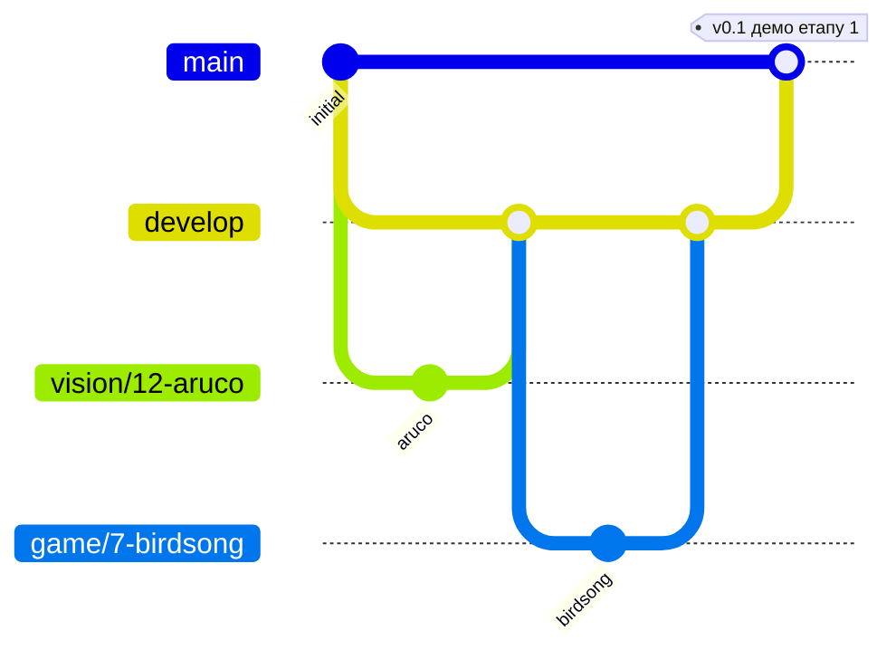

# Як ми працюємо

## Тікети

- Кожна задача оформлюється як **issue** на GitHub і лежить на дошці проєкту (Todo → In Progress → Review → Done).
- Мітки: трек (`game`, `vision`, `robot`, `app`, `hardware`, `docs`), тип (`feature`, `bug`, `research`),
  пріоритет (`P1`, `P2`, `P3`).
- Кожен issue прив'язаний до **milestone** (етап з [docs/roadmap.md](docs/roadmap.md)).
- Взяв задачу — признач себе й перетягни її в *In Progress*.

## Гілки та PR



| Гілка | Що в ній | Хто пише |
| --- | --- | --- |
| `main` | стабільна версія, яка точно працює на роботі. Оновлюється на демо в кінці етапу | merge з `develop` через PR |
| `develop` | поточна робота команди, **гілка за замовчуванням** на GitHub | merge робочих гілок через PR |
| `<трек>/<issue>-<коротко>` | одна задача, напр. `vision/12-aruco-homography` | автор задачі |

- Робочу гілку створюємо від `develop`, PR відкриваємо теж у `develop`.
- Пряме комітування в `main` і `develop` заборонене (branch protection).
- Після кожного демо етапу: PR `develop` → `main` і тег `v0.N`.
- PR маленькі: орієнтир до ~400 рядків змін. Велике краще розбити.
- В описі PR пишемо `Closes #12`, тоді issue закриється сам після merge. Це спрацьовує лише для
  гілки за замовчуванням, тому `develop` має бути default branch.
- **Мінімум 1 approve** від іншої людини. Зміни в інтерфейсах між модулями (див. architecture.md)
  схвалюють власники обох модулів.
- Merge: **Squash and merge**.

## Коміти

Коротко й по суті, англійською або українською (головне, щоб однаково в усій команді):

```text
vision: detect ArUco markers and compute homography
game: implement Mechanical Marquise move step
fix(robot): clamp target point to workspace bounds
```

## Код

- Python 3.10+, type hints обов'язкові для публічних функцій.
- Форматування та лінт: [`ruff`](https://docs.astral.sh/ruff/). Перед пушем: `ruff format . && ruff check .`
- Тести: `pytest`. Логіка в `game` **обов'язково** з тестами. Для `vision` тести на фікстурах-кадрах.
  `robot` тестуємо через `MockArm`.
- Магічних чисел у коді немає: усе в `config/`.
- Не комітимо: датасети, ваги моделей, файли калібрування, `config/local.yaml`, віртуальні оточення.

## Робота зі справжнім роботом

Спочатку прочитати [docs/hardware-and-safety.md](docs/hardware-and-safety.md). Коротко:
новий код руху запускаємо спочатку на `MockArm`, потім на низькій швидкості й **з людиною біля E-stop**.

## Документація

- Змінили поведінку модуля — онови відповідний файл у `docs/`.
- Важливі технічні рішення (вибір захвату, детектора, камери…) записуємо як ADR у
  [`docs/decisions/`](docs/decisions/) за шаблоном `template.md`.
