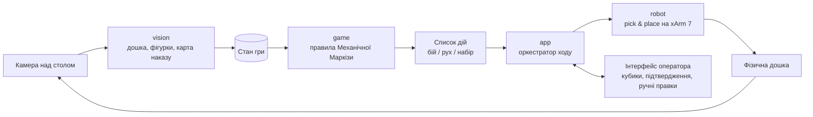

# RootBot — xArm 7 грає в Root

Університетський проєкт: роборука **UFACTORY xArm 7** грає з людьми в настільну гру
[**Root**](https://ledergames.com/products/root-a-game-of-woodland-might-and-right) за автоматизовану фракцію
**Механічна Маркіза** (Mechanical Marquise) з доповнення **Riverfolk**.

Робот сам «бачить» дошку через камеру, вирішує, що робити, за правилами бота і фізично переставляє своїх
воїнів на дошці. Люди грають як завжди, своїми руками.

> **Статус:** початкова структура, код ще не написаний. Дедлайн проєкту: **14.12.2026**.
> План дивіться в [docs/roadmap.md](docs/roadmap.md).

---

## Ідея в одному абзаці

Механічна Маркіза — це бот, який грає за чіткими правилами: відкриває карту наказу, і масть карти визначає,
на яких галявинах він атакує, рухається й набирає воїнів. Людині грати за такого бота нудно, бо це механічна
робота. Тому ми віддаємо її роботу: **камера** знімає дошку і рахує фігурки на кожній галявині, **ігровий рушій**
застосовує правила бота й видає список дій, **роборука** виконує ці дії фізично.

## Як це працює



Хід бота складається з таких кроків:

1. Люди завершують свої ходи й натискають «Хід бота».
2. Камера фотографує дошку, `vision` перетворює фото на стан: скільки чиїх фігурок стоїть на кожній галявині.
3. Оператор перевертає ліву карту наказу. Камера розпізнає її масть і вартість крафту.
4. `game` застосовує правила Механічної Маркізи й видає дії: «бій на галявині 3», «перемісти 2 воїнів з 3 на 7»,
   «додай 1 воїна на 5».
5. `app` проводить бої (кидки кубиків, люди знімають свої втрати) і дає команди роботу.
6. `robot` бере фігурки із запасу чи з галявин і ставить їх куди треба, а потім повертається в «домашню» позицію.
7. Камера перевіряє результат, і хід переходить до людей.

Детальніше: [docs/architecture.md](docs/architecture.md).

## Структура репозиторію

```text
.
├── src/rootbot/            # Увесь Python-код (один пакет, модулі нижче)
│   ├── common/             # Спільні типи: масті, фракції, координати
│   ├── game/               # Модель гри й правила бота. Без заліза, повністю тестується
│   ├── vision/             # Камера, детекція дошки (ArUco), фігурок, карт
│   ├── robot/              # Обгортка над xArm SDK, перетворення координат, pick & place, MockArm
│   └── app/                # Оркестратор ходу, інтерфейс оператора, точка входу
├── config/                 # YAML-конфіги: IP робота, камера, калібрування, модель мапи
├── scripts/                # Утиліти: калібрування, збір датасету, ручне керування рукою
├── tests/                  # pytest-тести (структура повторює src/rootbot)
├── hardware/               # CAD пальців захвату, кріплення камери, схема розміщення
├── docs/                   # Документація проєкту
├── data/                   # Фото й датасети (не в git, крім маленьких прикладів)
└── models/                 # Натреновані ваги моделей (не в git)
```

Чому один репозиторій, а не git-сабмодулі: [docs/decisions/0001-monorepo.md](docs/decisions/0001-monorepo.md).

## Швидкий старт

Потрібен **Python 3.10+**.

```bash
git clone https://github.com/olenakshyk/RootBot.git
cd RootBot

python -m venv .venv
# Windows:
.venv\Scripts\activate
# Linux / macOS:
source .venv/bin/activate

# Тільки ігрова логіка й тести:
pip install -e ".[dev]"

# Усе разом (камера + робот):
pip install -e ".[dev,vision,robot]"

pytest
```

Запуск **без робота і без камери** (робот замінений на MockArm, кадри читаються з теки),
коли з'явиться `app/main.py`:

```bash
python -m rootbot.app.main --mock-robot --mock-camera data/samples
```

> ⚠️ Перед роботою зі **справжньою** рукою прочитайте [docs/hardware-and-safety.md](docs/hardware-and-safety.md).

## Документація

| Документ | Про що |
| --- | --- |
| [docs/architecture.md](docs/architecture.md) | Модулі, інтерфейси між ними, системи координат, цикл ходу |
| [docs/game-rules.md](docs/game-rules.md) | Root і Механічна Маркіза: що саме реалізуємо в коді |
| [docs/vision.md](docs/vision.md) | Як розпізнаємо дошку, фігурки й карти |
| [docs/robot.md](docs/robot.md) | Керування xArm 7, pick & place, захват |
| [docs/calibration.md](docs/calibration.md) | Калібрування камера → дошка → робот |
| [docs/hardware-and-safety.md](docs/hardware-and-safety.md) | Обладнання, розміщення на столі, **правила безпеки** |
| [docs/roadmap.md](docs/roadmap.md) | Етапи, дедлайни, розподіл ролей |
| [docs/decisions/](docs/decisions/) | Записи архітектурних рішень (ADR) |
| [CONTRIBUTING.md](CONTRIBUTING.md) | Як працюємо з git, гілками, PR і тікетами |

## Команда

| Ім'я | Роль | GitHub |
| --- | --- | --- |
| _TBD_ | Ігрова логіка (`game`) | |
| _TBD_ | Комп'ютерний зір (`vision`) | |
| _TBD_ | Робототехніка (`robot`) | |
| _TBD_ | Інтеграція, UI, документація (`app`) | |

## Подяки

- **Root** і доповнення **Riverfolk**: © [Leder Games](https://ledergames.com/). Проєкт некомерційний, навчальний.
  Ми не викладаємо в репозиторій правила гри чи скани компонентів, лише власний опис того, що реалізуємо.
- [xArm Python SDK](https://github.com/xArm-Developer/xArm-Python-SDK) від UFACTORY.
