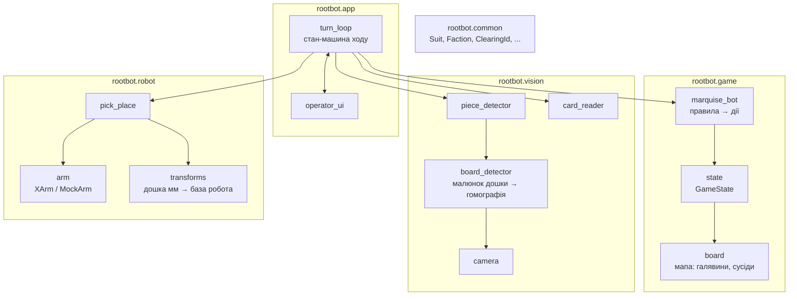
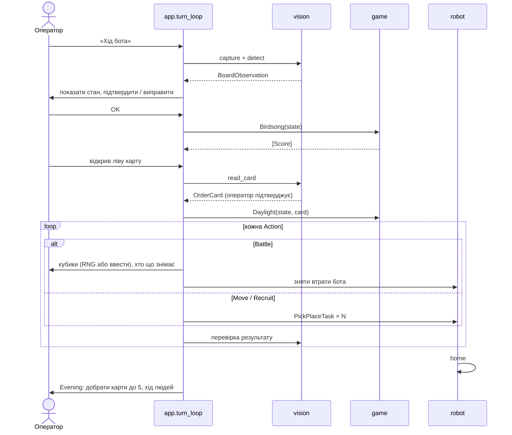

# Архітектура

## Принципи

1. **Кожен модуль можна розробляти без інших.** `game` не знає про камеру й робота. `robot` не знає правил гри.
   `vision` не знає, що робить бот. Їх з'єднує лише `app`.
2. **Без заліза теж працює.** Для камери є режим «читати фото з диска», для робота — `MockArm`.
   Ігрову логіку тестуємо звичайним `pytest` на CI.
3. **Камера — джерело істини про дошку.** Перед кожним ходом бота стан фігурок будується з кадру заново.
   Програма пам'ятає тільки те, чого не видно: рахунок, Keep, пріоритети.
4. **Людина завжди може виправити.** Кожен результат розпізнавання (стан дошки, карта наказу) оператор
   підтверджує або правит у UI. Помилка зору не повинна зупиняти гру.
5. **Безпека важливіша за швидкість.** Робот рухається лише в хід бота, лише після підтвердження оператора,
   з обмеженою швидкістю. Див. [hardware-and-safety.md](hardware-and-safety.md).

## Модулі



| Модуль | Відповідальність | Вхід | Вихід | Залежності |
| --- | --- | --- | --- | --- |
| `common` | Спільні типи й константи | — | — | — |
| `game` | Модель мапи, стан партії, правила Механічної Маркізи | `GameState`, карта наказу | список `Action` | `common` |
| `vision` | Кадр → стан дошки й карта наказу | кадр камери | `BoardObservation`, `OrderCard` | `common`, OpenCV |
| `robot` | Фізичні переміщення фігурок | `PickPlaceTask` (координати дошки, мм) | рух руки | `common`, xArm SDK |
| `app` | Оркестрація ходу, UI оператора, кубики | усе вище | — | усі модулі |

## Ключові інтерфейси

Ці типи — «контракт» між людьми в команді. Змінюємо їх тільки через PR, на який дивляться власники обох
модулів. Точні визначення з'являться в коді (`src/rootbot/...`), тут подано суть.

```python
# common: спільні типи
@dataclass
class PieceCounts:  # фігурки однієї фракції на одній галявині
    warriors: int  # панування = warriors + buildings,
    buildings: int  # «найбільше ворожих фігурок» = усе разом
    tokens: int
    pawn: int  # Бродяга (Vagabond)


@dataclass
class OrderCard:
    suit: Suit  # FOX / RABBIT / MOUSE / BIRD
    craft_cost: tuple[Suit, ...]  # порожній кортеж означає «немає вартості крафту»


# vision → app
@dataclass
class BoardObservation:
    pieces: dict[ClearingId, dict[Faction, PieceCounts]]  # хто що має на кожній галявині
    keep_clearing: ClearingId | None  # де лежить Keep (None, якщо не знайдено)
    # де саме стоять воїни бота (для захвату)
    bot_piece_positions: dict[ClearingId, list[BoardPoint]]
    free_spots: dict[ClearingId, list[BoardPoint]]  # куди можна поставити воїна
    confidence: float  # 0..1, якщо низька, UI просить перевірити
    board_shift_mm: float  # зсув дошки після калібрування; якщо великий, UI просить повернути її в упори


# game → app
Action = Battle | Move | Recruit | Score


@dataclass
class Battle:
    clearing: ClearingId
    defender: Faction


@dataclass
class Move:
    src: ClearingId
    dst: ClearingId
    count: int


@dataclass
class Recruit:
    clearing: ClearingId
    count: int


@dataclass
class Score:
    points: int
    reason: str


# app → robot
@dataclass
class PickPlaceTask:
    pick: BoardPoint  # мм у системі дошки, або SUPPLY
    place: BoardPoint  # мм у системі дошки, або SUPPLY
```

## Цикл ходу бота



Важливо: **дії `Move` залежать від результатів попередніх `Battle`.** Тому `game` не видає всі дії на хід
одразу. `app` викликає рушій крок за кроком (бій → оновити стан → рух → оновити стан → набір), і кожен
крок отримує актуальний `GameState`.

## Системи координат

| Система | Одиниці | Початок | Хто використовує |
| --- | --- | --- | --- |
| **Зображення** | пікселі | лівий верхній кут кадру | `vision` всередині |
| **Дошка** (`board`) | мм | кут дошки ліворуч на дальньому від робота боці, вісь X уздовж довгої сторони, Y до робота | **спільна мова** між `vision`, `game` (координати галявин) і `robot` |
| **Робот** (`base`) | мм | основа xArm 7 | `robot` всередині |

- **Зображення → Дошка:** гомографія за малюнком самої дошки (ключові точки ↔ еталонне зображення, без маркерів),
  рахується **на кожному кадрі**, тож якщо дошку штовхнули, підрахунок фігурок по галявинах не ламається.
- **Дошка → Робот:** жорстке 2D-перетворення (поворот + зсув) плюс висота стола Z.
  Калібрується один раз після встановлення стола, а також якщо зсунули робота чи дошку.
  Тому дошка лежить в упорах, а якщо її все ж зсунули, `vision` це помічає (`board_shift_mm`) і UI просить
  повернути дошку на місце.

Деталі: [calibration.md](calibration.md).

## Конфігурація

Усі «магічні числа» живуть у `config/`, не в коді:

- `config/default.yaml`: IP робота, швидкості, безпечні висоти, індекс камери, шляхи до файлів калібрування;
- `config/maps/autumn.yaml`: галявини, масті, сусіди, пріоритети, координати центрів;
- `config/calibration/*.yaml`: результати калібрування (генеруються скриптами, **у git не комітимо**,
  бо в кожного своє робоче місце).
