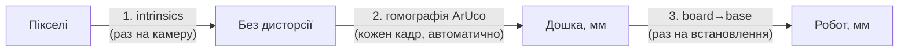

# Калібрування

Ланцюжок: **пікселі → мм дошки → мм бази робота**. Кожна ланка калібрується окремо.

## 1. Внутрішні параметри камери (intrinsics)

**Коли:** один раз для кожної камери, а також якщо змінили роздільність чи фокус.

1. Надрукувати шахівницю (напр. 9×6 клітинок по 25 мм) на жорсткій основі.
2. `python scripts/calibrate_camera.py --out config/calibration/camera.yaml`
3. Зняти 20–30 кадрів шахівниці під різними кутами по всьому полю кадру.
4. Перевірити, що похибка репроєкції < 0.5 px.

## 2. Камера → дошка

Відбувається **автоматично на кожному кадрі** за 4 маркерами ArUco.

Один раз треба виміряти **координати центрів маркерів у мм** відносно маркера #0 і записати їх у
`config/default.yaml` → `board.markers`. Міряти лінійкою або рулеткою, точність ±1 мм.

## 3. Дошка → робот

**Коли:** після кожного встановлення стола, а також якщо зсунули робота чи маркери.

1. Поставити на захват загострений наконечник (або використати центр пальців).
2. `python scripts/calibrate_board_to_robot.py`
3. Скрипт по черзі просить підвести TCP (через `jog_robot`) точно до центру кожного маркера й записує
   координати робота.
4. За 4+ парами точок (дошка мм ↔ робот мм) рахуємо поворот + зсув методом найменших квадратів (Kabsch / Umeyama 2D).
   Висоту стола беремо як середнє Z.
5. Скрипт виводить залишкову похибку. Ціль: **< 2 мм** на кожній точці.
6. Результат зберігається в `config/calibration/board_to_robot.yaml`.

## Перевірка всього ланцюжка

`python scripts/calibrate_board_to_robot.py --verify`: робот по черзі показує (зависає на 10 мм над точкою)
центри всіх 12 галявин з `autumn.yaml`. Якщо десь промахується більше ніж на 5 мм, перекалібрувати.

## Висоти (Z)

| Параметр | Що це | Як визначити |
| --- | --- | --- |
| `table_z` | поверхня дошки | з калібрування (крок 3) |
| `grasp_z` | висота захвату фігурки | `table_z` + ~половина висоти фігурки, підібрати |
| `release_z` | висота відпускання | `table_z` + 1–2 мм |
| `approach_z` | звідки починаємо повільно опускатися | `table_z` + 20 мм |
| `safe_z` | висота переміщення між точками | `table_z` + 80 мм (вище за будь-яку фігурку й руку людини поруч) |
