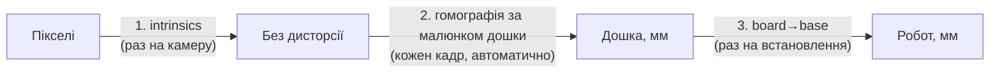

# Калібрування

Ланцюжок: **пікселі → мм дошки → мм бази робота**. Кожна ланка калібрується окремо.

## 1. Внутрішні параметри камери (intrinsics)

**Коли:** один раз для кожної камери, а також якщо змінили роздільність чи фокус.

1. Надрукувати шахівницю (напр. 9×6 клітинок по 25 мм) на жорсткій основі.
2. `python scripts/calibrate_camera.py --out config/calibration/camera.yaml`
3. Зняти 20–30 кадрів шахівниці під різними кутами по всьому полю кадру.
4. Перевірити, що похибка репроєкції < 0.5 px.

## 2. Камера → дошка

Відбувається **автоматично на кожному кадрі**, без маркерів: ключові точки кадру зіставляються з еталонним
зображенням дошки (див. [vision.md → V1](vision.md#v1-дошка)).

**Еталон** робимо один раз, а також якщо дошка почала погано знаходитися (нова камера, інше світло):

1. Виміряти зовнішні розміри дошки рулеткою (точність ±1 мм) і записати в `config/default.yaml` → `board.size_mm`.
2. Покласти під камеру **порожню** дошку в упори, увімкнути робоче освітлення, руку відвести в home.
3. `python scripts/make_board_reference.py --out data/reference/board_autumn.png`
4. Клікнути 4 кути дошки по порядку: (0, 0) → (довжина, 0) → (довжина, ширина) → (0, ширина).
   Початок координат — кут дошки ліворуч на дальньому від робота боці, X іде вздовж довгої сторони, Y — до робота
   (див. [схему розміщення](hardware-and-safety.md#розміщення-на-столі)).
5. Скрипт зберігає вид зверху з масштабом `board.warp_px_per_mm` і одразу пробує знайти дошку на кількох
   нових кадрах. Ціль: інлаєрів не менше за `board.detector.min_inliers`, кути дошки збігаються з кліками
   з точністю до 2 мм.

Еталон у git не комітимо (це фактично скан дошки), ділимося ним так само, як вагами моделей.

## 3. Дошка → робот

**Коли:** після кожного встановлення стола, а також якщо зсунули робота чи дошку (про зсув дошки попередить UI).

1. Поставити на захват загострений наконечник (або використати центр пальців).
2. `python scripts/calibrate_board_to_robot.py`
3. Скрипт показує еталон дошки. Клікаємо на ньому чітку точку: кут дошки або іншу деталь малюнка, яку легко
   знайти і на еталоні, і на справжній дошці. Скрипт переводить клік у мм дошки.
4. Підводимо TCP (через `jog_robot`) точно до цієї точки на справжній дошці, скрипт записує координати робота.
5. Повторюємо для 4–6 точок, рознесених якомога далі одна від одної (мінімум 3, не на одній прямій).
   До дальніх кутів дошки робот може не дотягнутися (див. [ризик №1](hardware-and-safety.md#-ризик-1-досяжність)),
   тоді беремо точки ближче.
6. За парами точок (дошка мм ↔ робот мм) рахуємо поворот + зсув методом найменших квадратів (Kabsch / Umeyama 2D).
   Вісь Y дошки направлена до робота, тож, якщо дивитися зверху, система дошки дзеркальна до бази робота:
   перед підгонкою беремо (x, −y), інакше чистим поворотом точки не сумістяться. Висоту стола беремо як середнє Z.
7. Скрипт виводить залишкову похибку. Ціль: **< 2 мм** на кожній точці.
8. Результат зберігається в `config/calibration/board_to_robot.yaml`. Туди ж скрипт записує, де на кадрі
   були кути дошки (`board_corners_px`): за ними `vision` помічає, що дошку зсунули після калібрування.

## Перевірка всього ланцюжка

`python scripts/calibrate_board_to_robot.py --verify`: робот по черзі показує (зависає на 10 мм над точкою)
центри всіх 12 галявин з `autumn.yaml`. Якщо десь промахується більше ніж на 5 мм, перекалібрувати.

## Висоти (Z)

| Параметр | Що це | Як визначити |
| --- | --- | --- |
| `table_z` | поверхня дошки | з калібрування (крок 3) |
| `grasp_z` | висота захвату фігурки | `table_z` + ~половина висоти фігурки, підібрати |
| `release_z` | висота відпускання | `table_z` + 1–2 мм |
| `approach_z` | звідки починаємо повільно опускатися | `table_z` + 20 мм |
| `safe_z` | висота переміщення між точками | `table_z` + 80 мм (вище за будь-яку фігурку й руку людини поруч) |
