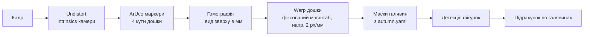

# Комп'ютерний зір

## Задачі

| # | Задача | Що повертає | Пріоритет |
| --- | --- | --- | --- |
| V1 | Знайти дошку на кадрі | гомографія зображення → дошка (мм) | MVP |
| V2 | Порахувати фігурки по галявинах | `{галявина: {фракція: кількість}}` | MVP |
| V3 | Знайти точні позиції воїнів бота | координати (мм) для захвату | MVP |
| V4 | Знайти Keep | галявина з Keep | MVP (або ручне введення) |
| V5 | Прочитати карту наказу | масть + вартість крафту | бажано (fallback: UI) |
| V6 | Знайти вільне місце в галявині | точка (мм), куди можна поставити воїна | MVP |
| V7 | Перевірити, що робот поставив фігурку | так / ні | бажано |

## Камера

- **Фіксована камера над столом**, об'єктив дивиться вниз. Рішення й обґрунтування:
  [decisions/0002-fixed-overhead-camera.md](decisions/0002-fixed-overhead-camera.md).
- Мінімум 1080p, бажано з ручним фокусом і експозицією: автоекспозиція «пливе», коли рука заходить у кадр.
- Освітлення рівне, без бліків. Дошка глянцева, тому лампу ставимо збоку, а не прямо над дошкою.
- Знімаємо лише коли рука в **home**-позиції й не перекриває дошку.

## Пайплайн

### V1: дошка

- Чотири маркери **ArUco** (словник `DICT_4X4_50`) друкуємо й клеїмо на картон **біля** кутів дошки.
  Саму дошку не псуємо. Дошку кладемо в рамку чи упори, щоб вона стояла приблизно на одному місці.
- `cv2.aruco.ArucoDetector` → 4 центри → `cv2.findHomography` → `warpPerspective`.
- На «розгорнутому» виді зверху кожна галявина займає **відоме коло** (центр і радіус з `config/maps/autumn.yaml`).

### V2–V4: фігурки

Почнемо з найпростішого, ускладнюватимемо лише за потреби:

1. **v0: колір (HSV-пороги).** Фігурки фракцій мають різні кольори: Маркіза помаранчева,
   Династія (Eyrie) синя, Альянс зелений… Сегментуємо за кольором, знаходимо зв'язні області, рахуємо.
   Проблема: фігурки, що стоять впритул, зливаються в одну область. Частково допомагає розділення за площею
   (одна область приблизно = N фігурок).
2. **v1: детектор (YOLO).** Якщо v0 помиляється частіше, ніж у ~5% кадрів. Клас = фракція × тип фігурки.
   Датасет знімаємо на нашій же дошці (`scripts/capture_dataset.py`), розмічаємо в Label Studio чи CVAT.
   Кілька сотень кадрів має вистачити для старту. ❓ Уточнити, чи є доступ до GPU в університеті.

Keep — жетон, а не воїн. Колір його відрізняється від воїнів, тож його можна шукати окремим класом.
Якщо не вийде, оператор вводить галявину Keep один раз на початку гри (Keep не рухається, його можна лише знищити).

### V5: карта наказу

- Відкрита карта лежить у **фіксованій зоні** на столі (позначеній стрічкою), камера бачить її на тому ж кадрі.
- Масть визначаємо за кольором фону або значком масті.
- Вартість крафту: шаблонний пошук значків мастей (template matching) у відомій області карти.
- **Fallback:** оператор обирає масть і вартість у UI за 2 кліки. Для MVP цього достатньо.

### V6: вільне місце

На масці галявини віднімаємо маски всіх знайдених фігурок і будівель (з відступом під пальці захвату)
і обираємо точку, найближчу до центру галявини. Якщо вільного місця немає, ставимо «поверх» центру
й повідомляємо оператора.

## Датасет і дані

- `data/raw/`: сирі кадри, `data/labeled/`: розмічені. Обидві теки **в `.gitignore`**.
- Для тестів кладемо кілька маленьких кадрів у `tests/vision/fixtures/` (до ~1 МБ кожен).
- Ваги моделей лежать у `models/` (теж ignored). Де зберігати спільно (Google Drive, HF Hub), домовимось окремо.

## Метрики

| Метрика | Ціль MVP |
| --- | --- |
| Точність підрахунку фігурок на галявині | ≥ 95% галявин без помилки |
| Похибка позиції воїна бота | ≤ 5 мм |
| Час обробки кадру | ≤ 2 с |
